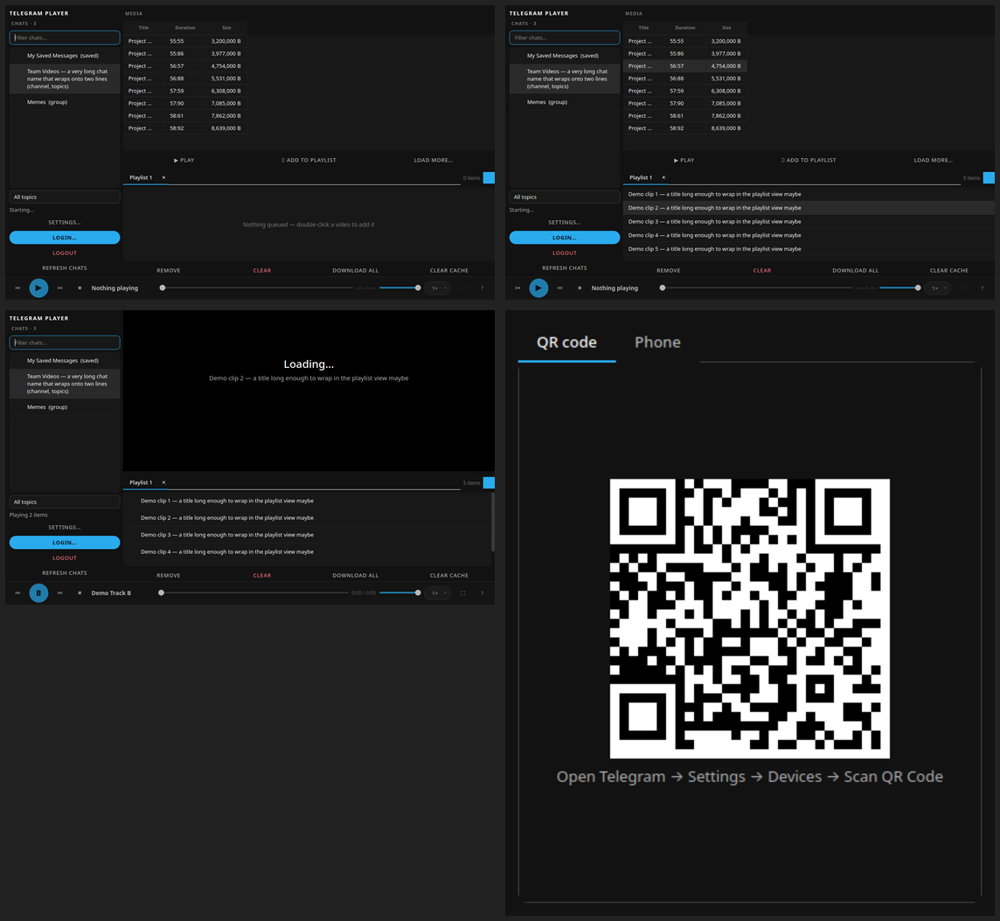

# Telegram Player

A minimal **Telegram video player** for the desktop. Browse the chats you have
access to, pick the videos you want, and play them in a clean, Spotify-style
dark UI — streamed from Telegram through a local byte-range server so playback
starts while the file is still downloading. Backed by [mpv](https://mpv.io) for
robust playback and [Telethon](https://github.com/LonamiWebs/Telethon) for the
Telegram API.



## Features

- **Login your way** — QR code (scan with the official app) or phone + code + 2FA.
- **Chat & media browser** — filter chats, drill into forum topics, and load a
  channel or group's media into a sortable table. Media-type tabs
  (**Videos / Audio / Photos & GIF / Other**) keep each category separate; the
  **Other** tab (PDFs, archives, …) offers **Download** instead of playback.
- **Instant playback** — mpv embeds directly into the window; media streams from
  a localhost byte-range server that serves bytes as they arrive, so playback
  begins immediately and continues while the rest downloads in the background.
- **Multiple playlists with tabs** — keep several playlists, switch between them,
  create new ones with `+`, close (✕) to delete, double-click a tab to rename.
  The active playlist is saved and restored on launch.
- **Tap-to-seek** — click or tap anywhere on the seek bar to jump there.
- **Fullscreen cinema mode** — the cursor and transport fade out after ~3.5s of
  inactivity and return on movement.
- **Centered, crisp transport icons**, volume control, playback-speed menu, and
  a keyboard-shortcut set (see [docs/KEYBOARD.md](docs/KEYBOARD.md)).
- **Automatic updates** — in the background the app checks GitHub
  Releases and offers to download and apply a newer build (one click on
  AppImage; opens the release page otherwise). Toggle it in **Settings**.
- **Local-first & private** — no accounts, no telemetry, no third-party
  servers. See [PRIVACY.md](PRIVACY.md).

## Requirements

- Linux (x86-64).
- An X11 session (or XWayland). The player embeds mpv into a native window, so it
  runs on the Qt `xcb` platform — pure Wayland is **not** supported.
- A Telegram API `api_id` / `api_hash` from
  [my.telegram.org](https://my.telegram.org) (paste them into **Settings**).
- `mpv` is bundled in the AppImage; for a pip install, `mpv` must be on your
  `PATH`.

## Install

### AppImage (recommended)
Download `Telegram-Player-<version>-x86_64.AppImage`, make it executable, and run:

```bash
chmod +x Telegram-Player-*.AppImage
./Telegram-Player-*.AppImage
```

### From PyPI-style source
```bash
python3 -m venv .venv && . .venv/bin/activate
pip install -e .
telegram-player
```

## Build from source

```bash
./build/build_appimage.sh      # produces dist/Telegram-Player-*.AppImage
```

The script pins `telethon`, `PyQt6`, `segno` and `pyinstaller`, builds (or
downloads) an mpv binary, and assembles the AppImage. Build tooling and
downloads live under `build/` (git-ignored).

## Quick start

1. On first launch, open **Settings** and paste your `api_id` / `api_hash`.
2. Click **Login…** and scan the QR code with the official Telegram app (or use
   phone + code + 2FA).
3. Pick a chat, then either **▶ Play** its videos or double-click individual
   videos to add them to the active playlist.
4. Use the tabs to manage multiple playlists; press **F** or double-click the
   video for fullscreen.

## Data & privacy

Your credentials and session are stored **locally only**; the app talks solely
to Telegram's API. The streaming server is bound to `127.0.0.1`. Full details in
[PRIVACY.md](PRIVACY.md).

## Project layout

| Path | Purpose |
| --- | --- |
| `telegram_player/ui/` | Qt UI: `main_window.py`, `theme.py`, dialogs |
| `telegram_player/tg_client.py` | Telethon service (own asyncio loop) |
| `telegram_player/mpv_ctl.py` | mpv JSON-IPC wrapper + embedding |
| `telegram_player/file_server.py` | localhost byte-range streaming server |
| `telegram_player/playlist.py` | playlist model + persistence |
| `telegram_player/config.py` | XDG paths + settings |
| `build/` | AppImage build tooling (git-ignored) |

See [docs/ARCHITECTURE.md](docs/ARCHITECTURE.md) for a deeper walkthrough.

## License

[MIT](LICENSE). This project is not affiliated with Telegram.
